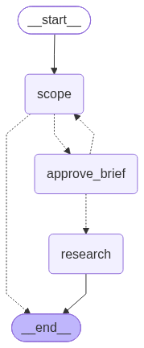
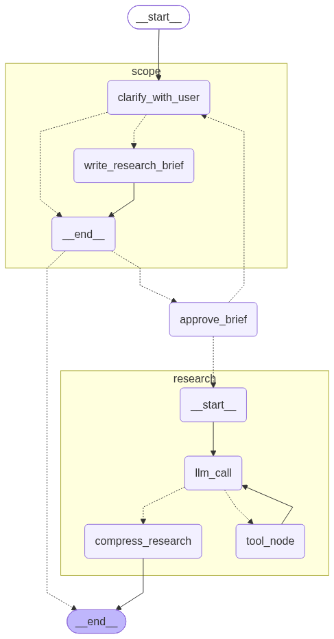
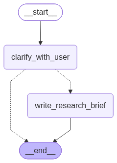

# Deepwell Researcher (FastAPI)

Deepwell is an agentic research assistant. You ask a question, Deepwell clarifies what you actually need, agrees a research brief with you, then researches the web and returns a sourced report.

This repository holds the backend: a FastAPI service that runs a LangGraph agent graph, with PostgreSQL for checkpointing, long-term store, and thread tracking. A separate Vue frontend consumes this API.

> **Status: work in progress.** The core graph and API are running. Code organization, tests, streaming, and deployment are actively being added. Expect breaking changes until `v0.1.0`.

---

## How it works

Deepwell is a parent LangGraph graph with two subgraphs and one human approval node between them.

<p align="center">
  
</p>

| Node            | Type     | Role                                                     |
| --------------- | -------- | -------------------------------------------------------- |
| `scope`         | Subgraph | Clarifies the request and drafts a research brief        |
| `approve_brief` | Node     | Pauses for the user to approve or revise the brief       |
| `research`      | Subgraph | Researches the approved brief and returns a cited report |

When the user asks for changes, `approve_brief` routes back to `scope` with the feedback. Once approved, it hands the brief to `research`.

### Full graph

The expanded view shows every node inside both subgraphs.

<p align="center">
  
</p>

### Scope stage

<p align="center">
  
</p>

`clarify_with_user` checks whether the request has enough detail. If not, it asks the user a question and pauses using LangGraph `interrupt()`. Once scope is clear, `write_research_brief` drafts the brief. The parent graph then pauses at `approve_brief`, and the user's answer resumes the graph through `Command(resume=...)`.

### Research stage

The researcher receives only the approved brief. `llm_call` and `tool_node` run a bounded tool calling loop (`web_search`, `think_tool`) to collect sourced evidence. When the loop ends, `compress_research` condenses the full tool history into a structured report. It keeps every fact and citation intact while cutting wording. Raw notes are kept separately as an audit trail for citation checks and debugging.

### State isolation

Each subgraph keeps private working state (`researcher_messages`, `notes`) and exposes only its output keys to the parent. Internal LLM calls are tagged, so tool calling tokens never leak into the user facing stream.

---

## Tech stack

| Layer               | Choice                                                 |
| ------------------- | ------------------------------------------------------ |
| API                 | FastAPI (async)                                        |
| Agent orchestration | LangGraph, LangChain                                   |
| LLM                 | OpenAI models (configurable per stage)                 |
| Persistence         | PostgreSQL: LangGraph checkpointer + store, app tables |
| ORM / migrations    | SQLAlchemy 2.x, Alembic                                |
| Validation          | Pydantic v2                                            |

---

## API

| Method | Endpoint        | Purpose                                            |
| ------ | --------------- | -------------------------------------------------- |
| `POST` | `/threads`      | Start a new research thread with the first message |
| `GET`  | `/threads/{id}` | Get thread details, status, stage, and messages    |

Each thread tracks two separate fields, so the frontend always knows what to render:

- `status`: `running`, `awaiting_input`, `done`, `failed`
- `stage`: `scoping`, `researching`, `reporting`

When `status` is `awaiting_input`, `input_kind` tells the client what the agent is waiting for: `question` or `brief_approval`.

Interactive docs are available at `/docs` once the server runs.

---

## Getting started

### Requirements

- Python 3.12+
- [uv](https://docs.astral.sh/uv/) for dependency management
- Docker and Docker Compose (runs PostgreSQL)
- An OpenAI API key
- A Tavily API key (for the researcher's search tool)

### Setup

```bash
git clone https://github.com/sarfrazrizwan/deepwell-researcher-fastapi.git
cd deepwell-researcher-fastapi

uv sync

cp .env.example .env
# fill in database credentials and API keys
```

### Database

PostgreSQL runs in Docker, so you don't need a local install.

```bash
# start PostgreSQL in the background
docker compose up -d

# create app tables (threads, etc.)
uv run alembic upgrade head
```

Make sure the `POSTGRES_*` values in `.env` match the credentials and port in `docker-compose.yml`.

LangGraph creates its own checkpoint and store tables on first run. Alembic is configured to ignore those tables, so autogenerate never tries to drop them.

### Run

```bash
uv run uvicorn app.main:app --reload --env-file .env
```

---

## Configuration

| Variable            | Description                                            |
| ------------------- | ------------------------------------------------------ |
| `POSTGRES_USER`     | PostgreSQL username                                    |
| `POSTGRES_PASSWORD` | PostgreSQL password                                    |
| `POSTGRES_DB`       | PostgreSQL database name                               |
| `OPENAI_API_KEY`    | OpenAI key for scope, research, and compression models |
| `TAVILY_API_KEY`    | Key for the web search tool                            |
| `SECRET_KEY`        | App secret key                                         |

See `.env.example` for the full list.

---

## Roadmap

- [x] Scope subgraph with clarifying questions and brief approval
- [x] Researcher subgraph with tool loop and compression
- [x] Postgres checkpointer and store
- [x] Threads table with status / stage tracking
- [x] Dockerized PostgreSQL for local development
- [ ] Reorganize into a clean `app/` module layout
- [ ] Token streaming over SSE
- [ ] Background job queue for long research runs (retries, durability)
- [ ] Parallel researchers coordinated by a supervisor
- [ ] Separate storage for raw notes outside the checkpoint
- [ ] Tests and CI
- [ ] Dockerize the API service and deploy publicly
- [ ] Vue frontend repository link

---

## Background

Deepwell is a minimal reference implementation of a research agent. It contains only the pieces a research agent needs to work end to end: scoping, human approval, a researcher tool loop, compression, and persistent state.

I use extended versions of this core in other projects, where I add domain specific tools and extra graph nodes on top. Keeping this repository minimal makes the base architecture easy to read, reuse, and build on.

I'm a backend engineer with 7+ years of Laravel production experience. The design choices here (status modelling, migrations, background work) come from running real production apps.
